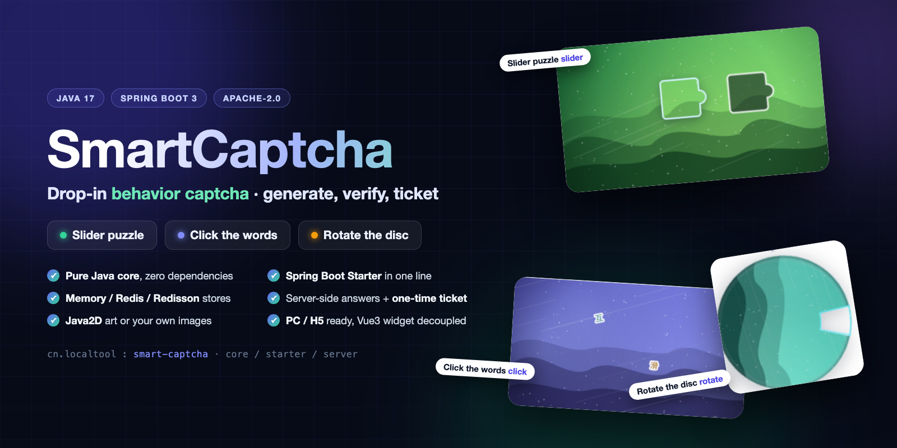
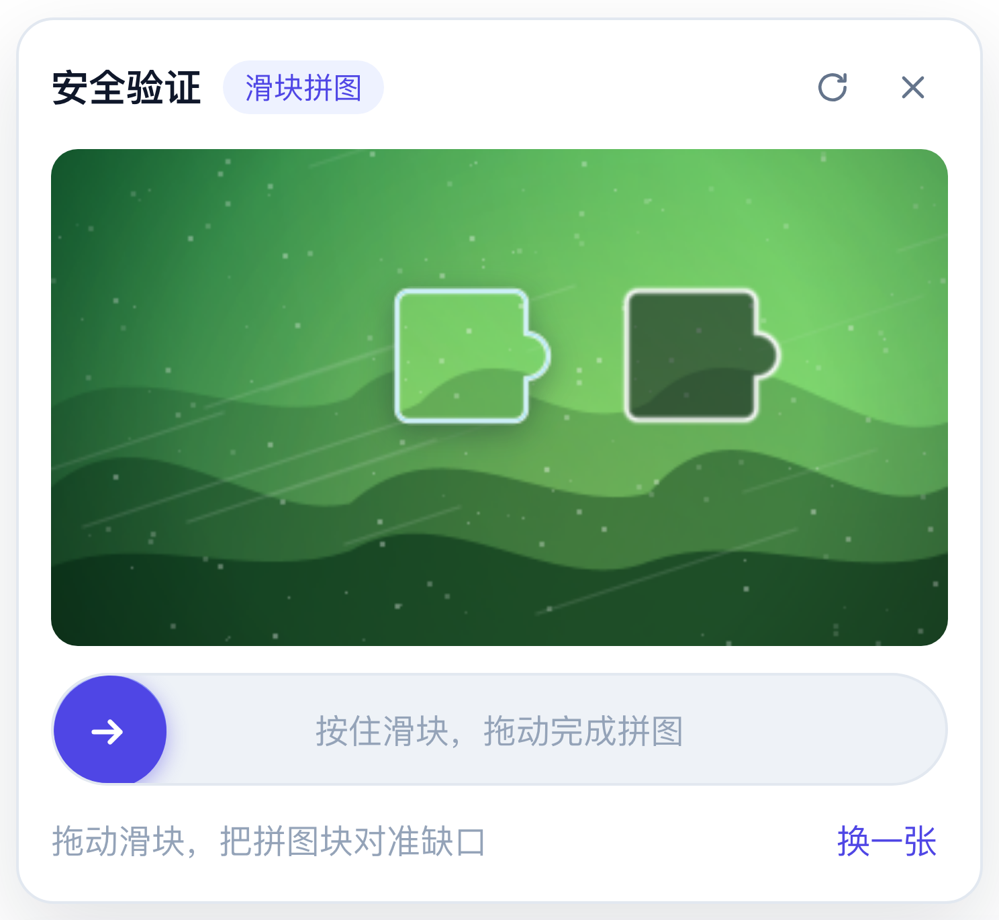
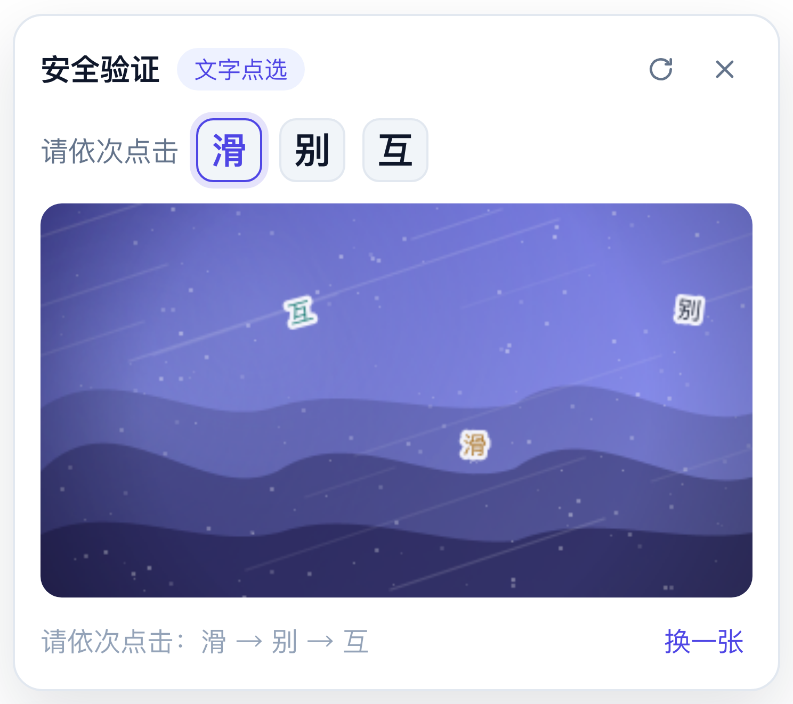
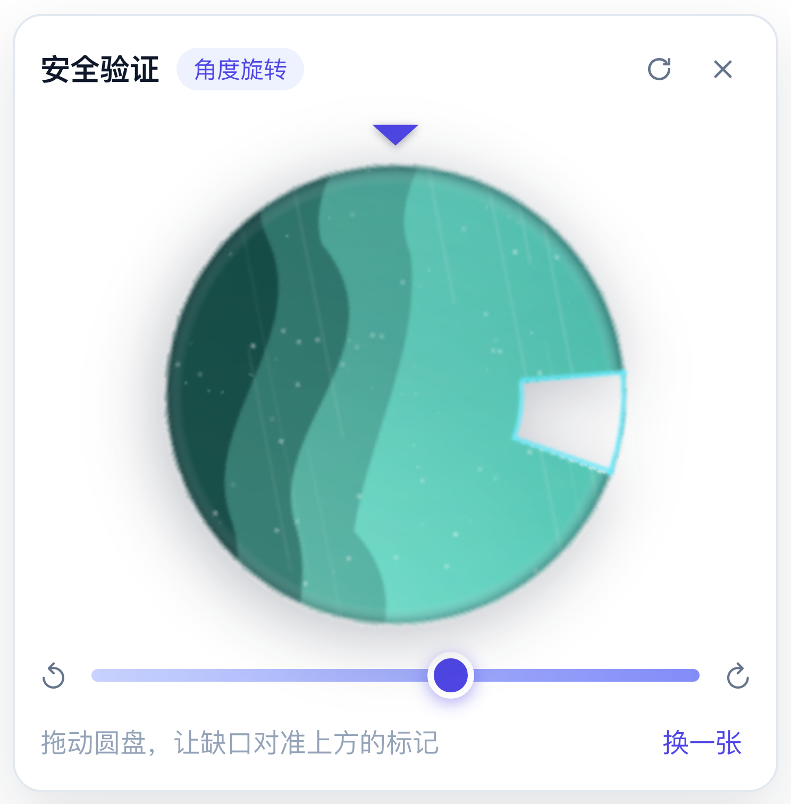

# SmartCaptcha

[English](README.md) | [简体中文](README.zh-CN.md)

[](LICENSE)



A complete behavior-captcha implementation: **Vue 3 component** (slider puzzle / click-the-words / rotate-the-disc) plus a **three-module Java backend** that renders the images, checks the answers and issues one-time tickets.

The backend is split so you can take only what you need:

| Module | Artifact | What it is | Runtime dependencies |
| --- | --- | --- | --- |
| **1. Core** | `cn.localtool:smart-captcha-core` | The captcha engine itself: three generators, Java2D rendering, answer checking, one-time tickets, `CaptchaStore` SPI with an in-memory implementation. | **JDK 17 only** — no Spring, no third-party jars |
| **2. Starter** | `cn.localtool:smart-captcha-spring-boot-starter` | Spring Boot 3 auto-configuration: `smart-captcha.*` properties, a ready `CaptchaEngine` bean, opt-in `@RequireCaptcha` + interceptor, Redis / Redisson stores. | core + `spring-boot-starter`; web / Spring Data Redis / Redisson are optional |
| **3. Server** | `cn.localtool:smart-captcha-server` | A runnable Spring Boot service exposing the REST API documented below (this is what the Vue demo talks to). | starter + web + data-redis + redisson |

The Vue component is **UI-only** — it never calls an API by itself. It asks the host page for a challenge and for verification through two events (`@request`, `@verify`), so you can plug in any transport: REST, GraphQL, an internal gateway, request signing, etc.

---

## Features

- **Three captcha types** with a unified widget: `slider`, `click`, `rotate`.
- **Inline or popup panel** — `display="inline"` (default) expands right under the bar; `display="popup"` shows a centered modal with a mask (ESC / click-outside to close).
- **Configurable or random** — pin one type, or let the server (`type=auto`) or the component (`types` pool) pick randomly.
- **Backgrounds, four ways** — server-side procedural art (zero assets), an external image array supplied by the page, or server-side sources: a folder, individual files, remote URLs or classpath resources.
- **PC + mobile H5** — Pointer Events for mouse/touch parity, percentage-based layout, no fixed pixel math, responsive panel.
- **Server-side answers** — correct position/angle never leaves the backend; `id + token` pair, 3 attempts max, one-time ticket after success.
- **Pluggable on both ends** — add a captcha type by implementing `CaptchaGenerator`, change the session storage by implementing `CaptchaStore` (six methods).

## Examples

The three widgets, captured live from the demo page (backgrounds are generated procedurally by the backend — no image assets needed):

| Slider puzzle | Click the words | Rotate the disc |
| :---: | :---: | :---: |
|  |  |  |
| Drag the handle to align the piece with the gap | Click the three characters in the given order | Rotate the disc until the notch points at the marker |

---

## Project layout

```
SmartCaptcha/                                   # parent POM (Spring Boot 3.5.11 / Java 17, BOM only)
├── smart-captcha-core/                         # ① pure Java engine
│   └── src/main/java/cn/localtool/smartcaptcha/core/
│       ├── CaptchaEngine.java                  #   generate + verify + ticket
│       ├── CaptchaConfig.java                  #   plain POJO config (no Spring)
│       ├── CaptchaType, CaptchaChallenge, CaptchaSession, CaptchaAnswer,
│       │   VerifyInput, VerifyResult, Coordinate, CaptchaException
│       ├── generator/                          #   slider / click / rotate (SPI)
│       ├── store/                              #   CaptchaStore + MemoryCaptchaStore
│       └── support/                            #   BackgroundFactory (Java2D), image utils
├── smart-captcha-spring-boot-starter/          # ② Spring Boot starter
│   └── src/main/java/cn/localtool/smartcaptcha/spring/
│       ├── SmartCaptchaProperties.java         #   extends CaptchaConfig, binds smart-captcha.*
│       ├── autoconfigure/                      #   5 auto-configurations + store-type condition
│       ├── store/                              #   RedisCaptchaStore, RedissonCaptchaStore
│       └── web/                                #   @RequireCaptcha, CaptchaInterceptor, CaptchaTicketException
├── smart-captcha-server/                       # ③ runnable service
│   └── src/main/java/cn/localtool/smartcaptcha/server/
│       ├── SmartCaptchaServerApplication.java
│       ├── controller/                         #   /api/captcha/**, /api/demo/login
│       └── web/                                #   request DTOs, ApiResult, exception handler
└── vue3/
    ├── public/backgrounds/                     # sample external background images
    └── src/
        ├── components/BehaviorCaptcha.vue     # UI-only widget
        ├── components/captcha/*Stage.vue      # slider / click / rotate interaction
        ├── api/captcha.js                     # demo REST helpers (used by the page, NOT by the widget)
        └── App.vue                            # demo page wiring @request / @verify
```

---

## Quick start

Requirements: JDK 17+, Maven 3.6+, Node 20+, pnpm/npm.

```bash
# build everything (three modules, run all tests)
mvn clean install

# run the server module → http://localhost:8088  (needs the install above, it resolves core/starter locally)
mvn -pl smart-captcha-server spring-boot:run
#   …or run the fat jar
java -jar smart-captcha-server/target/smart-captcha-server-1.9.0.jar

# frontend → http://localhost:5173  (vite proxies /api to 127.0.0.1:8088)
cd vue3
pnpm install
pnpm dev
```

Handy demo URLs: `?demo=slider`, `?demo=click`, `?demo=rotate`, plus `&bg=ext` to use the external background array.
Point the dev server somewhere else with `CAPTCHA_API_TARGET=http://host:port pnpm dev`.

---

## Module 1 — using the core without Spring

The core is a plain library. Everything works with `new`:

```java
import cn.localtool.smartcaptcha.core.*;

CaptchaEngine engine = new CaptchaEngine();          // default config + in-memory store

CaptchaChallenge challenge = engine.generate("slider");   // null type = random
// challenge.image() is a PNG dataURL — send id / token / image to the browser

VerifyResult result = engine.verify(
        VerifyInput.slider(challenge.id(), challenge.token(), 213.5));
if (result.success()) {
    String ticket = result.ticket();                 // opaque, single use
    boolean accepted = engine.consumeTicket(ticket);
}
```

Tune it through `CaptchaConfig`, and swap the pluggable parts through the builder:

```java
CaptchaConfig config = new CaptchaConfig();
config.setWidth(320);
config.setHeight(180);
config.setMaxAttempts(5);
config.getClick().setCharset("en");                  // Chinese by default

CaptchaEngine engine = CaptchaEngine.builder(config)
        .store(new MySharedStore())                  // any CaptchaStore (Redis, JDBC, …)
        .generator(new MyVoiceGenerator())           // any CaptchaGenerator; same type overrides built-in
        .build();
```

Notes:

- `CaptchaEngine` is stateless and thread-safe; keep one instance per application.
- `MemoryCaptchaStore` starts a daemon sweeper thread — call `close()` (or let Spring do it via `destroyMethod`).
- `CaptchaGenerator` implementations listed in `META-INF/services/cn.localtool.smartcaptcha.core.generator.CaptchaGenerator` are discovered automatically by `ServiceLoader`; explicit `.generator(…)` registrations win.
- Zero dependencies means zero logging framework: the core logs through `java.util.logging`, which Spring Boot already bridges to SLF4J/Logback.

---

## Module 2 — using the starter in an existing Spring Boot 3 app

The artifacts are not on Maven Central; install them locally first — run this **from the repository root** (not with `-pl`), so every module including the parent is installed:

```bash
mvn clean install
```

The POMs written to the local repository are **flattened** by `flatten-maven-plugin`: they contain no `<parent>` reference and pin all versions. A consumer project therefore only needs `smart-captcha-spring-boot-starter` + `smart-captcha-core` in its repository — the aggregator POM is never resolved. Then:

```xml
<dependency>
    <groupId>cn.localtool</groupId>
    <artifactId>smart-captcha-spring-boot-starter</artifactId>
    <version>1.9.0</version>
</dependency>
```

That gives you an auto-configured `CaptchaEngine` bean, the `smart-captcha.*` properties, and (opt-in) the ticket interceptor:

```java
@Service
public class LoginService {

    private final CaptchaEngine captcha;          // injected, already configured

    public LoginService(CaptchaEngine captcha) {
        this.captcha = captcha;
    }

    public String login(String username, double sliderX, String id, String token) {
        var result = captcha.verify(VerifyInput.slider(id, token, sliderX));
        return result.success() ? issueJwt(username) : "captcha failed: " + result.message();
    }
}
```

**The interceptor is off by default** (`smart-captcha.interceptor.enabled=false`): the starter never touches your endpoints, and each business endpoint validates the ticket it receives. Turn it on when you'd rather have the check done once, before the method runs:

```yaml
smart-captcha:
  interceptor:
    enabled: true        # default false
```

```java
@PostMapping("/login")
@RequireCaptcha                       // throws CaptchaTicketException (HTTP 403) when the ticket is missing/expired/used
public LoginResult login(@RequestBody LoginRequest req) { ... }
```

Prefer doing it yourself? Keep the switch off and consume the ticket in the method — one line, any moment you like:

```java
@PostMapping("/login")
public LoginResult login(@RequestBody LoginRequest req, @RequestHeader("X-Captcha-Ticket") String ticket) {
    if (!captcha.consumeTicket(ticket)) {          // one-time: false on missing / expired / replayed
        throw new CaptchaTicketException("Please complete the captcha first", "X-Captcha-Ticket");
    }
    ...                                            // credential check, business logic
}
```

The starter only judges and **throws** — it never writes a response body, so the payload stays your project's contract (`ApiResult` lives in the server module, not in the starter). Map it once in your own advice:

```java
@RestControllerAdvice
public class CaptchaAdvice {
    @ExceptionHandler(CaptchaTicketException.class)
    @ResponseStatus(HttpStatus.FORBIDDEN)
    public MyResult<Void> onTicket(CaptchaTicketException e) {
        return MyResult.fail(CaptchaTicketException.CODE, e.getMessage());   // 4004 → re-run the widget
    }
}
```

With no advice at all you still get a plain 403, because the exception is annotated `@ResponseStatus(FORBIDDEN)`.

Everything is conditional: no web dependency → only the engine + store are configured; no Redis dependency → `store.type=redis` falls back to memory with a warning instead of failing startup. Add `spring-boot-starter-data-redis` / `redisson` only if you actually use them.

---

## Module 3 — the REST service

The server module is the reference implementation: it wires the starter, exposes the API below, and serves the demo page's backend.

| Method | Path | Description |
| --- | --- | --- |
| GET | `/api/captcha/config` | Available types, canvas size, tolerances, TTL |
| POST | `/api/captcha/generate` | Body `{"type":"slider\|click\|rotate\|auto","backgroundImage":"optional dataURL","clickCharset":"optional zh\|en"}` |
| GET | `/api/captcha/generate?type=auto` | Simplification without external background |
| POST | `/api/captcha/verify` | Verify behavior, returns a one-time `ticket` on success |
| POST | `/api/captcha/ticket/verify` | Business API consumes the ticket (single use) — for cross-service use |
| POST | `/api/demo/login` | Demo business endpoint guarded by `@RequireCaptcha` (interceptor mode) |
| POST | `/api/demo/login-manual` | Same flow with the interceptor off — the method calls `consumeTicket` itself |

Envelope: `{ "code": 0, "success": true, "message": "ok", "data": {...} }` — this `ApiResult` belongs to the server module; the starter imposes no response shape.
`code`: `0` ok, `4001` bad request, `4002` expired/unknown captcha, `4003` attempts exhausted, `4004` invalid/used ticket, `5000` server error.
Note that `code: 0` on `/verify` only means "request handled" — check `data.success`.

### Generate response (abridged)

```json
{
  "code": 0,
  "data": {
    "id": "…", "token": "…", "type": "slider",
    "width": 360, "height": 200,
    "image": "data:image/png;base64,…",
    "slider": { "piece": "data:…", "pieceWidth": 65, "pieceHeight": 56, "y": 48 },
    "click":  { "words": ["验", "证", "码"], "charset": "zh" },
    "rotate": { "size": 200 },
    "expireIn": 120,
    "tip": "拖动滑块，把拼图块对准缺口"
  }
}
```

Answers (target x, word centers, target angle) are stored server-side only.

### Verify response

```json
{ "code": 0, "data": { "success": true, "status": "PASS", "message": "验证通过", "ticket": "b1c2…" } }
{ "code": 0, "data": { "success": false, "status": "FAIL", "message": "验证失败，还剩 2 次机会", "attemptsLeft": 2 } }
```

---

## Frontend component

```vue
<script setup>
import BehaviorCaptcha from '@/components/BehaviorCaptcha.vue'
import { generateCaptcha, verifyCaptcha } from '@/api/captcha.js'

// 1) the page decides where a challenge comes from
async function handleRequest({ type }, done) {
  try {
    done(await generateCaptcha('', { type }))   // done(challenge)
  } catch (e) {
    done(null, e)                               // done(null, error)
  }
}

// 2) the page decides how to verify
async function handleVerify(payload, done) {
  try {
    done(await verifyCaptcha('', payload))      // payload: {id, token, type, duration, x|points|angle}
  } catch (e) {
    done(null, e)
  }
}
</script>

<template>
  <BehaviorCaptcha
    type="auto"
    :types="['slider', 'click', 'rotate']"
    @request="handleRequest"
    @verify="handleVerify"
    @success="({ ticket }) => submitLogin(ticket)"
    @fail="({ message }) => console.warn(message)"
  />
</template>
```

### Props

| Prop | Type | Default | Description |
| --- | --- | --- | --- |
| `type` | `String` | `'auto'` | `auto` \| `slider` \| `click` \| `rotate` |
| `types` | `Array` | `['slider','click','rotate']` | Random pool used when `type="auto"` |
| `display` | `String` | `'inline'` | `inline` expands under the bar; `popup` renders a centered modal with mask |
| `barText` | `String` | `'点击进行安全验证'` | Text on the collapsed bar |
| `successText` | `String` | `'验证成功'` | Text after passing |
| `autoRefresh` | `Boolean` | `true` | Fetch a new challenge automatically after a failed attempt |
| `defaultOpen` | `Boolean` | `false` | Expand and load on mount (either display mode) |
| `eventTimeout` | `Number` | `15000` | Reject if `done()` is not called in time (ms) |

Changing `type` at runtime reloads the challenge automatically with the new type (if the panel is collapsed, it loads on the next open). Call `refresh()` only when you need a new challenge for the **same** configuration — for example after switching the background source. Since props are applied on the next render, do `await nextTick()` before calling it; otherwise the widget still sees the old value.

`display` only changes presentation — the events, `defaultOpen`, `refresh()` and the exposed API behave identically in both modes. In `popup` mode the panel is teleported to `<body>` (so it is never clipped by a scrolling/overflow container), the page scroll is locked while it is open, ESC or a click on the mask closes it, and it closes itself ~0.9 s after a successful verification. Switching `display` while the panel is open moves it between the two layouts in place.

### Events

| Event | Signature | Description |
| --- | --- | --- |
| `request` | `({ type }, done)` | Ask the host for a challenge. Call `done(challenge)` or `done(null, error)`. |
| `verify` | `(payload, done)` | Submit the user's behavior. Call `done({ success, ticket, message, attemptsLeft })` or `done(null, error)`. |
| `success` | `({ id, type, ticket })` | Verification passed; send the ticket to your business API. |
| `fail` | `({ message, attemptsLeft })` | Verification failed. |
| `refresh` | `(type)` | A new challenge has been loaded. |
| `close` | `()` | The panel was collapsed. |

### Exposed API (via template ref)

```js
const captchaRef = ref(null)
// <BehaviorCaptcha ref="captchaRef" ... />
```

| Member | Signature | Description |
| --- | --- | --- |
| `isVerified()` | `() => boolean` | Whether the widget has passed (has a ticket, not invalidated by refresh/reset) |
| `getState()` | `() => { verified, phase, type, ticket, open, loading, display }` | Snapshot of the current state — handy as a final gate before submitting business data |
| `refresh(options?)` | `({ open?: boolean }) => Promise<state>` | Fetch a new challenge; the old ticket is invalidated. `open: true` also expands the panel |
| `reset()` | `() => void` | Clear everything and collapse the panel |
| `verified` / `state` | reactive (computed) | Bind them directly in templates, e.g. `{{ captchaRef?.state?.verified ? '✓' : '…' }}` |
| `ticket` / `phase` | reactive (refs) | Legacy escape hatch; prefer `getState()` |

```js
// before submitting business data
if (!captchaRef.value?.isVerified()) {
  alert('请先完成人机验证')
  return
}
const { ticket } = captchaRef.value.getState()
```

> Note: `isVerified()` reflects local widget state only — it cannot know whether the ticket was already consumed server-side. After a business submit succeeds or is rejected with 403, call `refresh()` / `reset()` to sync the local state (that's what the demo does).

`payload` passed to `@verify` is already scaled to the original image coordinate system, so any backend using the same contract can verify it directly:

```json
{ "id": "…", "token": "…", "type": "slider", "duration": 1820, "x": 213.5 }
{ "id": "…", "token": "…", "type": "click",  "duration": 2400, "points": [{"x":80,"y":42},{"x":210,"y":120}] }
{ "id": "…", "token": "…", "type": "rotate", "duration": 1500, "angle": 96.5 }
```

---

## Guarding business endpoints with the ticket

`ticket` is the only thing the browser gets after passing. It is opaque, **single use**, and expires after `ticket-expire-seconds` (default 300s). The widget never decides "passed" — your backend does:

1. The page receives the ticket from `@success` and attaches it to the business request.
2. The business backend consumes it **before** touching any business data.
3. Invalid → HTTP 403 with `{"code":4004}`, and the page re-runs the widget.

**Same application — interceptor mode** (`smart-captcha.interceptor.enabled=true`, what the demo's `DemoController#login` does):

```java
@PostMapping("/login")
@RequireCaptcha                    // interceptor consumes the ticket before the method runs
public ApiResult<LoginResult> login(@RequestBody LoginRequest req) { ... }   // server's own envelope
```

```js
await fetch('/api/login', {
  method: 'POST',
  headers: { 'Content-Type': 'application/json', 'X-Captcha-Ticket': ticket },
  body: JSON.stringify({ username, password }),
})
```

`CaptchaInterceptor` reads the header (rename via `@RequireCaptcha(header = "…")`, falls back to the `captchaTicket` request parameter), consumes the ticket, and exposes it as `CaptchaInterceptor.TICKET_ATTRIBUTE` for audit logging. Only annotated endpoints are checked, and everything passes through when `smart-captcha.enabled=false`. On rejection it throws `CaptchaTicketException` — the 403 comes from its `@ResponseStatus`, the body from your advice.

**Same application — self-check mode** (the default, `DemoController#loginManually`):

```java
@PostMapping("/login-manual")
public ApiResult<LoginResult> login(@RequestBody LoginRequest req,
                                    @RequestHeader(value = "X-Captcha-Ticket", required = false) String ticket) {
    if (!captcha.consumeTicket(ticket)) {                // one-time consume, false when missing/expired/replayed
        throw new CaptchaTicketException("Please complete the captcha first", "X-Captcha-Ticket");
    }
    ...                                                  // business logic runs only after that
}
```

**Want to choose the moment yourself?** Even with the interceptor on, inject `CaptchaEngine` and call `captcha.consumeTicket(ticket)` — for example *after* the password check, so a typo doesn't force a new captcha (at the cost of letting the same ticket be retried).

**Separate service?** `POST /api/captcha/ticket/verify {"ticket":"…"}` → `{"data":{"valid":true}}`. Call it from your business backend, never from the browser — a client-side gate is not a gate.

Operational notes:

- Consuming at entry means a failed login also burns the ticket. Consuming after credential validation is friendlier but retry-able; pick per endpoint.
- The default store is in-memory and per JVM. In a cluster, back `CaptchaStore` with Redis (six small methods) so every node sees the same tickets.
- Need scene binding (login vs. reset-password) or IP/user binding? Extend `issueTicket` / `consumeTicket`; today a ticket is valid for any guarded endpoint.

---

## Configuration (`application.yaml`)

```yaml
smart-captcha:
  enabled: true
  expire-seconds: 120                 # challenge TTL
  max-attempts: 3                     # attempts per challenge
  ticket-expire-seconds: 300          # ticket TTL
  allow-types: [slider, click, rotate]
  width: 360                          # canvas size
  height: 200
  min-duration-ms: 0                  # >0 rejects suspiciously fast submissions
  allowed-origins: ["*"]              # CORS for /api/**
  interceptor:
    enabled: false                    # default: business endpoints verify the ticket themselves
  slider: { piece-size: 52, tolerance: 8 }
  click:  { word-count: 3, display-count: 5, tolerance: 22, font-size: 30, charset: zh, font-path: "", font-family: "" }
  rotate: { size: 200, tolerance: 8 }
  background:
    locations: []                     # mixed sources: folder | file path | https URL | classpath:*
    dir: ""                           # legacy alias, merged into locations
    ratio: 50                         # % chance to use an external image (rest: procedural)
    connect-timeout-ms: 3000          # remote image timeouts
    read-timeout-ms: 5000
    refresh-seconds: 0                # remote cache TTL, 0 = fetch once at startup
  store:
    type: memory                      # memory (default) | redis | redisson
    key-prefix: smart-captcha
    address: redis://127.0.0.1:6379   # redisson only
    password: ""                      # redisson only
    database: 0                       # redisson only
```

The same keys work in any Spring Boot 3 application that depends on the starter. Without Spring, set the equivalent fields on `CaptchaConfig`.

---

## Storage backends

Sessions and one-time tickets go through `CaptchaStore`. Two ship in the box, one is a one-liner away:

| `store.type` | Implementation | Module | Notes |
| --- | --- | --- | --- |
| `memory` (default) | `MemoryCaptchaStore` — `ConcurrentHashMap` + scheduled eviction | core | Zero dependencies; data is per-instance and lost on restart. Fine for a single node. |
| `redis` | `RedisCaptchaStore` — Spring Data Redis `StringRedisTemplate` | starter | Reuses Spring Boot's standard `spring.data.redis.host/port/password/database`. |
| `redisson` | `RedissonCaptchaStore` — Redisson client | starter | Connection from `smart-captcha.store.address/password/database`; reuses an existing `RedissonClient` bean when present. |

Key layout (identical for both Redis implementations, plain UTF-8 values):

```
{prefix}:session:{id}    HASH   token / type / answer(JSON) / expireAt
{prefix}:attempts:{id}   STRING failure counter, INCR-based
{prefix}:ticket:{ticket} STRING consumed atomically with GETDEL
```

- Every key carries a TTL, so expired challenges are reclaimed by Redis itself — no sweeper needed.
- Attempts use `INCR` and tickets use `GETDEL`, so concurrent/replayed requests can't double-spend a ticket.
- `redis` and `redisson` are **optional** dependencies of the starter: unknown types and missing driver classes fall back to memory with a warning instead of failing startup.
- Register your own `CaptchaStore` bean (`@Bean` of your own type) to override the assembly entirely.
- `GET /api/captcha/config` reports the active backend as `store`.

Local Redis for trying it out:

```bash
docker compose up -d redis
mvn -pl smart-captcha-server spring-boot:run \
  -Dspring-boot.run.arguments="--smart-captcha.store.type=redis"
```

---

## Extending

**Different rendering / checking for an existing type** — implement `CaptchaGenerator` (core) and register it. Same `type()` overrides the built-in generator; Spring Boot picks up every `CaptchaGenerator` bean automatically:

```java
/** Same wire format as the built-in slider, custom rendering + answer. */
public class MySliderGenerator implements CaptchaGenerator {
    @Override public CaptchaType type() { return CaptchaType.SLIDER; }
    @Override public GenerationResult generate(BufferedImage bg, CaptchaConfig cfg, Random r) { … }
}
```

A brand-new interaction style (beyond slider / click / rotate) also needs a value in `CaptchaType` plus its own field in `CaptchaChallenge`/`VerifyInput`, since both are the wire contract with the widget.

**New storage** — implement the six methods of `CaptchaStore` and declare the bean; `@ConditionalOnMissingBean` makes it win over every built-in store.

---

## Click-word charset and font

The click captcha draws either Chinese characters or Latin letters:

- `smart-captcha.click.charset`: `zh` (Chinese, **default**) or `en` (uppercase A–Z, confusing glyphs like I/O/Q excluded).
- Per-request override: `"clickCharset": "en"` in the generate body (or `?clickCharset=en` on the GET variant) — handy for bilingual sites.
- The actual charset used is returned in `data.click.charset`, and the UI prompt switches with it (`请依次点击` / `Click in order`).
- **More characters than clicks**: `smart-captcha.click.display-count` (>= `word-count`) draws extra distractor characters on the image; only `word-count` of them appear in the tip and the answer, so distractors can't pass verification. Default `0` = same as `word-count`.

**Custom font.** By default the generator uses the `SansSerif` logical font (the JVM maps it to platform fonts). You can override it three ways:

```yaml
smart-captcha:
  click:
    font-family: "Alibaba PuHuiTi"               # family name, used as-is (no installed-check)
    # or a font file (ttf / otf): absolute / relative path (~ expands) or a classpath resource
    # font-path: classpath:fonts/Xingkai.ttf     # e.g. /data/fonts/Xingkai.ttf
```

```java
// Full control (pure core or Spring): pass a java.awt.Font object
Font myFont = Font.createFont(Font.TRUETYPE_FONT, Path.of("/fonts/Xingkai.ttf"))
        .deriveFont(Font.BOLD);
config.getClick().setFont(myFont);
```

No validation is performed and no font is recommended: once an external font is set it is used as-is — priority `click.font` (the `Font` object) → `click.font-path` (font file) → `click.font-family` → `SansSerif` otherwise. Font files are read once and cached (files keyed by path + last modified time); the drawn size always follows `click.font-size` (a `Font` object keeps its style, a font file is drawn bold). The only fallback is when a font file itself cannot be loaded (missing or corrupt) — that degrades to the default with a warning and never fails the captcha.

---

## Background images

1. **Procedural (default).** `BackgroundFactory` paints gradients, glows, layered hills, light streaks, particles and a vignette with Java2D — no assets required.
2. **External array (page side).** The page picks a URL from its own array, converts it to a base64 dataURL (`imageToDataUrl`), and passes it as `backgroundImage`. The backend crops it and cuts the puzzle out of it. Requires same-origin or CORS-enabled images.
3. **Server-side sources — folder, files, URLs or classpath.** List any mix in `smart-captcha.background.locations`; every entry is one of:

   | Kind | Example | Behaviour |
   | --- | --- | --- |
   | Folder | `/data/captcha/bg`, `~/Pictures/bg` | scanned recursively (max depth 5), png/jpg/jpeg/gif/bmp/webp |
   | Single file | `/data/captcha/bg/01.jpg` | reloaded automatically when the file changes |
   | Remote image | `https://cdn.example.com/bg/02.jpg` | prefetched in the background at startup, cached in memory, refreshed per `refresh-seconds` |
   | Classpath resource | `classpath:captcha-bg/03.png`, `classpath:captcha-bg/*` (`**` = recursive) | ships inside the fat jar |

   ```yaml
   smart-captcha:
     background:
       locations:
         - /data/captcha/bg            # a whole folder
         - /data/captcha/bg/hero.jpg   # …or one file
         - https://cdn.example.com/bg/2.jpg   # …or a remote URL
         - classpath:captcha-bg/*      # …or resources packaged in the jar
       ratio: 50                       # % of challenges that use an external image
       refresh-seconds: 3600           # re-download remote images hourly
   ```

   Missing folders, broken files or unreachable URLs only log a warning and fall back to the procedural background — captcha generation never fails because of a bad image. `smart-captcha.background.dir` still works and is merged into `locations`. Call `engine.backgrounds().reload()` to rescan after dropping new files into a folder.

---

## Security notes

- Answers live in `CaptchaStore` (memory by default, or Redis/Redisson when configured) and are never serialized into responses.
- `id + token` pair; a wrong token is treated as expired, so ids cannot be probed.
- Attempt limit per challenge, single-use challenge, single-use ticket.
- Business endpoints must be guarded server-side: `@RequireCaptcha` (or `engine.consumeTicket`) — the ticket alone is not proof of anything until a server consumes it.
- You can enable `min-duration-ms` to reject instant submissions from scripts.
- For production: set `smart-captcha.store.type=redis` (or `redisson`) behind a shared Redis, and add per-IP rate limiting.
- Transports are plain JSON; run behind HTTPS in production.

See `docs/captcha-verification-and-ticket.md` for a full analysis of the verification logic and what can (and cannot) be forged.

---

## Tests

```bash
mvn test          # all three modules
mvn -pl smart-captcha-core test   # engine only, no Spring context at all
```

| Module | Cases | Covers |
| --- | --- | --- |
| core | 59 | three types (pass + fail), attempt lockout, ticket single-use, click charset (zh / en), CJK pool of 2000 common characters, click distractors (`display-count`, 3), custom click font (Font object / font file by path & classpath / family, used as-is without validation, 14), `auto` type pool, `min-duration-ms`, custom generator override, memory-store contract (8), background sources: folder / file list / remote URL / classpath wildcard / reload / ratio / fallback (13) |
| starter | 47 | auto-configuration (default memory, unknown type fallback), store-type normalisation, `smart-captcha.background.*` + `click.font-family` / `click.font-path` binding + engine wiring (6), the same `CaptchaStore` contract on **redis** and **redisson** (8 each), engine-over-Redis flow (2), interceptor throwing `CaptchaTicketException` instead of writing a body (9), 403 mapping without any advice (2), interceptor switch: off by default / on by config (6) |
| server | 13 | REST contract (config / generate / verify / error codes), 4 MockMvc cases for the guarded business endpoint (missing / bogus / replayed ticket, captcha API stays open) and 2 for the self-check endpoint |

Total: 119 cases. The 18 Redis-backed cases **skip automatically** when no server is reachable; point them elsewhere with `-Dtest.redis.host=… -Dtest.redis.port=…` (or `REDIS_HOST` / `REDIS_PORT`).

---

## Troubleshooting

| Symptom | Cause | Fix |
| --- | --- | --- |
| `Unresolved dependency: 'cn.localtool:smart-captcha-parent:jar:1.9.0'` in IntelliJ | the IDE picked up a POM installed **before** the POMs were flattened, or its local repository differs from the one the CLI installs into | `mvn clean install` at the repo root, then *Reload All Maven Projects*; verify IDEA → *Settings → Build Tools → Maven → Local repository* and install into exactly that path: `mvn -Dmaven.repo.local=<that path> install` |
| `Dependency 'cn.localtool:smart-captcha-spring-boot-starter:1.9.0' not found` | never installed, or installed into another local repository | same as above; also make sure you did not run `mvn install -pl smart-captcha-spring-boot-starter` without `-am` |
| `NoClassDefFoundError: …CaptchaInterceptor` / Redis store missing | `spring-boot-starter-web`, `spring-boot-starter-data-redis` and `redisson` are **optional** dependencies of the starter | add the ones you actually use to your own project |

---

## License

[Apache License 2.0](LICENSE) © 2026 zhj

You are free to use, modify and redistribute this project (including commercially), as long as you retain the copyright and license notices and state significant changes. Attribution details are in [NOTICE](NOTICE).
