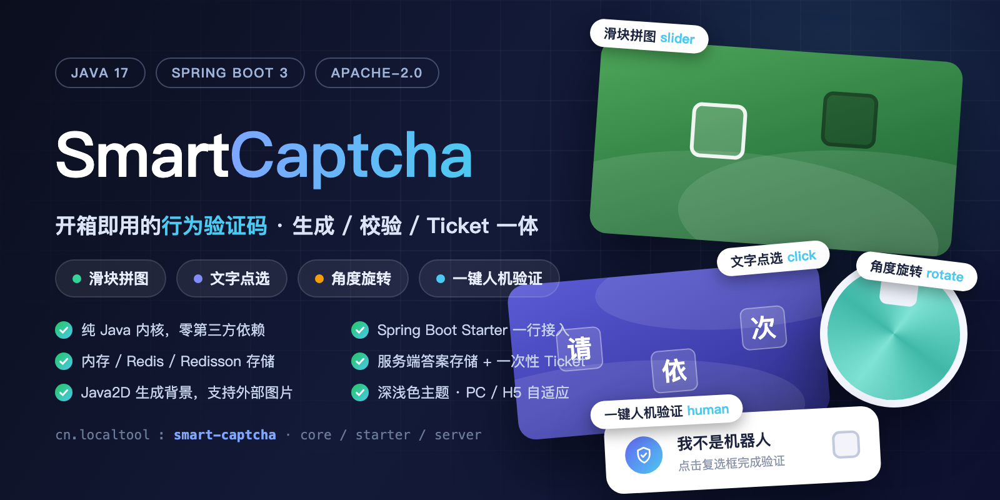
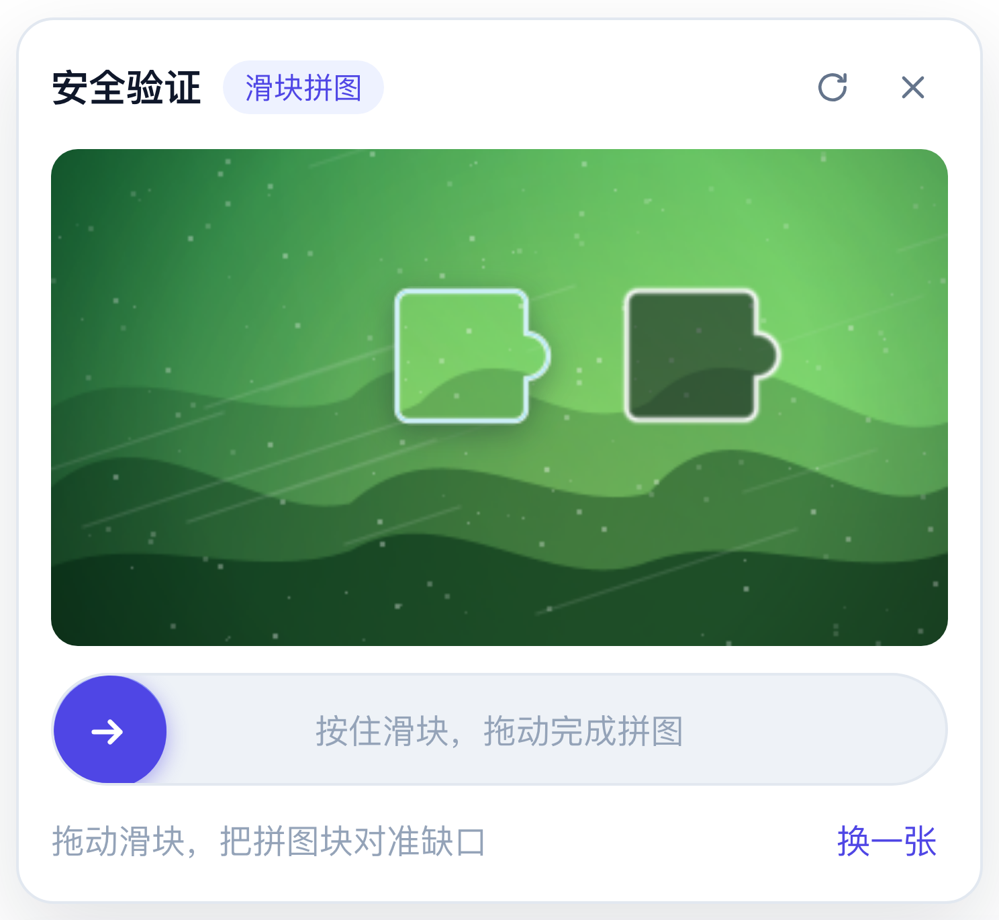
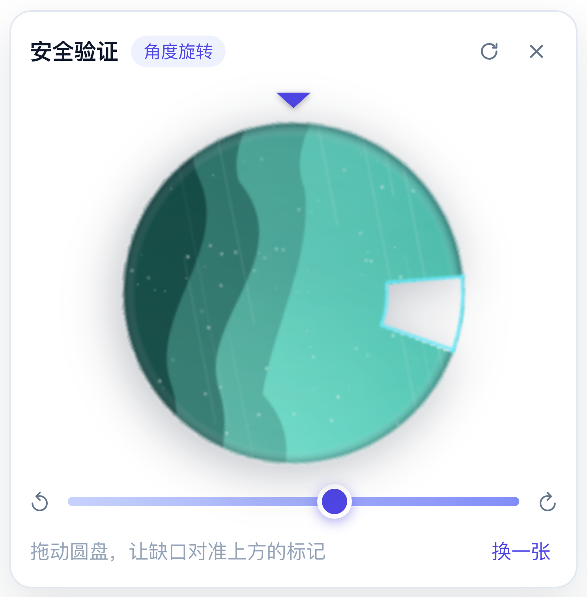

# SmartCaptcha 行为验证码

[English](README.md) | [简体中文](README.zh-CN.md)

[](LICENSE)



一套完整的行为验证码实现：**Vue 3 组件**（滑块拼图 / 文字点选 / 角度旋转）+ **三模块 Java 后端**（生成图片、校验答案、签发一次性 ticket）。

后端拆成三个模块，用什么引什么：

| 模块 | 坐标 | 是什么 | 运行时依赖 |
| --- | --- | --- | --- |
| **① 内核** | `cn.localtool:smart-captcha-core` | 验证码引擎本体：三种生成器、Java2D 绘图、答案校验、一次性 ticket，`CaptchaStore` SPI + 内存实现 | **只要 JDK 17**，不依赖 Spring，无任何第三方 jar |
| **② Starter** | `cn.localtool:smart-captcha-spring-boot-starter` | Spring Boot 3 自动装配：`smart-captcha.*` 配置、开箱可用的 `CaptchaEngine` Bean、按需开启的 `@RequireCaptcha` + 拦截器、Redis / Redisson 存储 | 内核 + `spring-boot-starter`；web / Spring Data Redis / Redisson 均为可选 |
| **③ 服务** | `cn.localtool:smart-captcha-server` | 可直接启动的 Spring Boot 服务，提供下文全部 REST 接口（Vue 演示页连的就是它） | starter + web + data-redis + redisson |

前端组件是**纯 UI** 的，内部不发起任何请求：它通过 `@request` / `@verify` 两个事件向宿主页面索取验证码数据与校验结果，因此后端可以是 REST、GraphQL、内部网关或带签名的私有协议，换后端不用改组件。

---

## 特性

- **三种验证方式**，同一个组件：`slider` 滑块拼图、`click` 文字点选、`rotate` 角度旋转。
- **内联 / 弹窗两种呈现**：`display="inline"`（默认）在触发条下方就地展开；`display="popup"` 居中弹窗 + 遮罩，ESC 或点遮罩关闭。
- **可固定可随机**：固定一种，或由服务端（`type=auto`）随机，或由组件按 `types` 池随机。
- **背景图四种来源**：服务端程序化生成（零素材）、页面传入的外部图片数组，以及服务端任意混合配置——目录 / 单个文件 / 远程 URL / classpath 资源。
- **PC + 手机 H5**：Pointer Events 统一鼠标与触屏，百分比定位，面板宽度自适应，无需 resize 监听。
- **答案只在服务端**：`id + token` 双凭证、默认 3 次尝试、通过后签发一次性 ticket。
- **两端都可插拔**：实现 `CaptchaGenerator` 换生成逻辑，实现 `CaptchaStore`（6 个方法）换会话存储。

## 示例

三种验证方式的实际界面，截取自演示页（背景由后端程序化生成，无需任何素材）：

| 滑块拼图 | 文字点选 | 角度旋转 |
| :---: | :---: | :---: |
|  |  |  |
| 拖动滑块，把拼图块对准缺口 | 按提示顺序依次点击三个汉字 | 旋转圆盘，让缺口对准上方标记 |

---

## 目录结构

```
SmartCaptcha/                                   # 父 POM（Spring Boot 3.5.11 / Java 17，只做版本管理）
├── smart-captcha-core/                         # ① 纯 Java 内核
│   └── src/main/java/cn/localtool/smartcaptcha/core/
│       ├── CaptchaEngine.java                  #   生成 + 校验 + ticket
│       ├── CaptchaConfig.java                  #   纯 POJO 配置（与 Spring 无关）
│       ├── CaptchaType、CaptchaChallenge、CaptchaSession、CaptchaAnswer、
│       │   VerifyInput、VerifyResult、Coordinate、CaptchaException
│       ├── generator/                          #   滑块 / 点选 / 旋转三个生成器（SPI）
│       ├── store/                              #   CaptchaStore + MemoryCaptchaStore
│       └── support/                            #   BackgroundFactory（Java2D 绘图）、图片工具
├── smart-captcha-spring-boot-starter/          # ② Spring Boot starter
│   └── src/main/java/cn/localtool/smartcaptcha/spring/
│       ├── SmartCaptchaProperties.java         #   继承 CaptchaConfig，绑定 smart-captcha.*
│       ├── autoconfigure/                      #   5 个自动配置类 + store.type 条件判断
│       ├── store/                              #   RedisCaptchaStore、RedissonCaptchaStore
│       └── web/                                #   @RequireCaptcha、CaptchaInterceptor、CaptchaTicketException
├── smart-captcha-server/                       # ③ 可运行的服务
│   └── src/main/java/cn/localtool/smartcaptcha/server/
│       ├── SmartCaptchaServerApplication.java
│       ├── controller/                         #   /api/captcha/**、/api/demo/login
│       └── web/                                #   请求 DTO、ApiResult、统一异常处理
└── vue3/
    ├── public/backgrounds/                     # 示例外部背景图
    └── src/
        ├── components/BehaviorCaptcha.vue      # 纯 UI 组件
        ├── components/captcha/*Stage.vue       # 三种交互子组件
        ├── api/captcha.js                      # 示例 REST 封装（页面使用，组件不引用）
        └── App.vue                             # 演示页，接 @request / @verify
```

---

## 快速开始

环境：JDK 17+、Maven 3.6+、Node 20+、pnpm/npm。

```bash
# 构建全部三个模块（含全部测试）
mvn clean install

# 启动服务模块 → http://localhost:8088（依赖上面的 install，core/starter 从本地仓库解析）
mvn -pl smart-captcha-server spring-boot:run
#   或者直接跑 fat jar
java -jar smart-captcha-server/target/smart-captcha-server-1.9.0.jar

# 前端 → http://localhost:5173（vite 已代理 /api 到 127.0.0.1:8088）
cd vue3
pnpm install
pnpm dev
```

演示页 URL 参数：`?demo=slider`、`?demo=click`、`?demo=rotate`，加 `&bg=ext` 使用外部背景图数组。
后端起在别的地址时用 `CAPTCHA_API_TARGET=http://host:port pnpm dev`。

---

## 模块一：不依赖 Spring 直接使用内核

内核就是普通类库，全部 `new` 出来即可：

```java
import cn.localtool.smartcaptcha.core.*;

CaptchaEngine engine = new CaptchaEngine();          // 默认配置 + 内存存储

CaptchaChallenge challenge = engine.generate("slider");   // 传 null 表示随机
// challenge.image() 是 PNG dataURL，把 id / token / image 发给前端

VerifyResult result = engine.verify(
        VerifyInput.slider(challenge.id(), challenge.token(), 213.5));
if (result.success()) {
    String ticket = result.ticket();                 // 不透明凭证，一次性
    boolean accepted = engine.consumeTicket(ticket);
}
```

通过 `CaptchaConfig` 调参，通过构建器替换可插拔部分：

```java
CaptchaConfig config = new CaptchaConfig();
config.setWidth(320);
config.setHeight(180);
config.setMaxAttempts(5);
config.getClick().setCharset("en");                  // 默认中文

CaptchaEngine engine = CaptchaEngine.builder(config)
        .store(new MySharedStore())                  // 任意 CaptchaStore（Redis、JDBC…）
        .generator(new MyVoiceGenerator())           // 任意 CaptchaGenerator；同类型会覆盖内置实现
        .build();
```

要点：

- `CaptchaEngine` 无状态、线程安全，全应用一个实例即可。
- `MemoryCaptchaStore` 会起一个守护清理线程，用完请 `close()`（Spring 里用 `destroyMethod`）。
- 放在 `META-INF/services/cn.localtool.smartcaptcha.core.generator.CaptchaGenerator` 里的实现会被 `ServiceLoader` 自动发现；显式 `.generator(…)` 注册的优先级更高。
- 零第三方依赖意味着不引入日志框架：内核用 `java.util.logging`，Spring Boot 本来就会把它桥接到 SLF4J/Logback。

---

## 模块二：在已有 Spring Boot 3 项目里用 starter

构件没有发布到 Maven 中央仓库，先本地安装——**在仓库根目录执行**（不要用 `-pl`），这样父 POM 与三个模块都会被装进仓库：

```bash
mvn clean install
```

装进本地仓库的 POM 已由 `flatten-maven-plugin` **扁平化**：不带 `<parent>` 引用、所有版本号都是字面量。因此别的项目只需要本地仓库里有 `smart-captcha-spring-boot-starter` 和 `smart-captcha-core`，**完全不需要解析聚合父 POM**。然后在业务项目里加：

```xml
<dependency>
    <groupId>cn.localtool</groupId>
    <artifactId>smart-captcha-spring-boot-starter</artifactId>
    <version>1.9.0</version>
</dependency>
```

即可获得自动装配好的 `CaptchaEngine` Bean、`smart-captcha.*` 配置项，以及（按需开启的）ticket 拦截器：

```java
@Service
public class LoginService {

    private final CaptchaEngine captcha;          // 注入，配置已生效

    public LoginService(CaptchaEngine captcha) {
        this.captcha = captcha;
    }

    public String login(String username, double sliderX, String id, String token) {
        var result = captcha.verify(VerifyInput.slider(id, token, sliderX));
        return result.success() ? issueJwt(username) : "captcha failed: " + result.message();
    }
}
```

**拦截器默认关闭**（`smart-captcha.interceptor.enabled=false`）：starter 不碰任何业务接口，由业务接口自己校验前端传来的 ticket。如果想统一在方法执行前校验一次，打开开关即可：

```yaml
smart-captcha:
  interceptor:
    enabled: true        # 默认 false
```

```java
@PostMapping("/login")
@RequireCaptcha                       // ticket 缺失/过期/已用时抛 CaptchaTicketException（HTTP 403）
public LoginResult login(@RequestBody LoginRequest req) { ... }
```

想自己决定校验时机？保持开关关闭，在方法里消费 ticket 即可——一行代码，时机随意：

```java
@PostMapping("/login")
public LoginResult login(@RequestBody LoginRequest req, @RequestHeader("X-Captcha-Ticket") String ticket) {
    if (!captcha.consumeTicket(ticket)) {          // 一次性消费；缺失 / 过期 / 重放都返回 false
        throw new CaptchaTicketException("请先完成人机验证", "X-Captcha-Ticket");
    }
    ...                                            // 之后再走账号密码校验和业务逻辑
}
```

starter 只做判断并**抛异常**，不写任何响应体——返回结构留在你自己的项目里（`ApiResult` 在 server 模块，不在 starter 里）。在全局异常处理里映射一次即可：

```java
@RestControllerAdvice
public class CaptchaAdvice {
    @ExceptionHandler(CaptchaTicketException.class)
    @ResponseStatus(HttpStatus.FORBIDDEN)
    public MyResult<Void> onTicket(CaptchaTicketException e) {
        return MyResult.fail(CaptchaTicketException.CODE, e.getMessage());   // 4004 → 前端重走验证码
    }
}
```

完全不写 advice 也不会 500：异常上标了 `@ResponseStatus(FORBIDDEN)`，最差也是一次干净的 403。

所有装配都是有条件的：没有 web 依赖时只装配引擎和存储；没有 Redis 依赖时 `store.type=redis` 会打一条警告并回退内存，而不是让应用启动失败。只有真的用到 Redis / Redisson 时才需要额外引入 `spring-boot-starter-data-redis` / `redisson`。

---

## 模块三：REST 服务

服务模块是参考实现：接入 starter、暴露下面的接口、给演示页当后端。

| 方法 | 路径 | 说明 |
| --- | --- | --- |
| GET | `/api/captcha/config` | 可用方式、画布尺寸、容错值、有效期 |
| POST | `/api/captcha/generate` | Body `{"type":"slider\|click\|rotate\|auto","backgroundImage":"可选 dataURL","clickCharset":"可选 zh\|en"}` |
| GET | `/api/captcha/generate?type=auto` | 不传外部背景图时的简化调用 |
| POST | `/api/captcha/verify` | 校验用户行为，通过时返回一次性 `ticket` |
| POST | `/api/captcha/ticket/verify` | 业务侧消费 ticket（一次性），跨服务场景用 |
| POST | `/api/demo/login` | 受 `@RequireCaptcha` 保护的演示业务接口（拦截器模式） |
| POST | `/api/demo/login-manual` | 同样流程，但拦截器关闭，方法内自己调 `consumeTicket` |

统一响应包装：`{ "code": 0, "success": true, "message": "ok", "data": {...} }`（`ApiResult` 属于 server 模块，starter 不规定任何返回结构）。
`code`：`0` 成功、`4001` 参数错误、`4002` 验证码不存在或已过期、`4003` 尝试次数耗尽、`4004` ticket 无效或已使用、`5000` 服务异常。
注意 `/verify` 的 `code=0` 只代表"请求被正常处理"，是否通过要看 `data.success`。

### 生成响应（节选）

```json
{
  "code": 0,
  "data": {
    "id": "…", "token": "…", "type": "slider",
    "width": 360, "height": 200,
    "image": "data:image/png;base64,…",
    "slider": { "piece": "data:…", "pieceWidth": 65, "pieceHeight": 56, "y": 48 },
    "click":  { "words": ["验", "证", "码"], "charset": "zh" },
    "rotate": { "size": 200 },
    "expireIn": 120,
    "tip": "拖动滑块，把拼图块对准缺口"
  }
}
```

答案（目标横坐标、文字中心点、目标角度）只存在于服务端。

### 校验响应

```json
{ "code": 0, "data": { "success": true, "status": "PASS", "message": "验证通过", "ticket": "b1c2…" } }
{ "code": 0, "data": { "success": false, "status": "FAIL", "message": "验证失败，还剩 2 次机会", "attemptsLeft": 2 } }
```

---

## 前端组件

```vue
<script setup>
import BehaviorCaptcha from '@/components/BehaviorCaptcha.vue'
import { generateCaptcha, verifyCaptcha } from '@/api/captcha.js'

// 1) 页面决定验证码从哪来
async function handleRequest({ type }, done) {
  try {
    done(await generateCaptcha('', { type }))   // done(challenge)
  } catch (e) {
    done(null, e)                               // done(null, error)
  }
}

// 2) 页面决定怎么校验
async function handleVerify(payload, done) {
  try {
    done(await verifyCaptcha('', payload))      // payload: {id, token, type, duration, x|points|angle}
  } catch (e) {
    done(null, e)
  }
}
</script>

<template>
  <BehaviorCaptcha
    type="auto"
    :types="['slider', 'click', 'rotate']"
    @request="handleRequest"
    @verify="handleVerify"
    @success="({ ticket }) => submitLogin(ticket)"
    @fail="({ message }) => console.warn(message)"
  />
</template>
```

### Props

| 属性 | 类型 | 默认值 | 说明 |
| --- | --- | --- | --- |
| `type` | `String` | `'auto'` | `auto` \| `slider` \| `click` \| `rotate` |
| `types` | `Array` | `['slider','click','rotate']` | `type="auto"` 时的随机池 |
| `display` | `String` | `'inline'` | `inline` 在触发条下方展开；`popup` 居中弹窗 + 遮罩 |
| `barText` | `String` | `'点击进行安全验证'` | 收起状态条上的文案 |
| `successText` | `String` | `'验证成功'` | 通过后的文案 |
| `autoRefresh` | `Boolean` | `true` | 校验失败后自动换一张 |
| `defaultOpen` | `Boolean` | `false` | 挂载即展开并加载（两种展示方式都适用） |
| `eventTimeout` | `Number` | `15000` | `done()` 超时时间（毫秒） |

运行时修改 `type` 会自动按新方式重新加载（若面板是收起的，则下次展开时加载）。`refresh()` 只在**配置没变、只想换一张**时用（比如切换了背景图来源）；由于 props 在下一轮渲染才生效，调用前请 `await nextTick()`，否则组件读到的还是旧值。

`display` 只影响呈现方式——事件、`defaultOpen`、`refresh()` 与对外方法在两种模式下行为完全一致。`popup` 模式下面板会被 Teleport 到 `<body>`（因此不会被父级 `overflow: hidden` 或滚动容器裁掉），打开期间锁定页面滚动，ESC 或点击遮罩关闭，验证通过后约 0.9 秒自动收起；面板展开时切换 `display`，会原地在两种布局间切换。

### 事件

| 事件 | 签名 | 说明 |
| --- | --- | --- |
| `request` | `({ type }, done)` | 向宿主索取验证码。调 `done(challenge)` 或 `done(null, error)`。 |
| `verify` | `(payload, done)` | 提交用户行为。调 `done({ success, ticket, message, attemptsLeft })` 或 `done(null, error)`。 |
| `success` | `({ id, type, ticket })` | 校验通过，把 ticket 交给业务接口。 |
| `fail` | `({ message, attemptsLeft })` | 校验失败。 |
| `refresh` | `(type)` | 已加载新的验证码。 |
| `close` | `()` | 面板被收起。 |

### 暴露的方法（通过模板 ref）

```js
const captchaRef = ref(null)
// <BehaviorCaptcha ref="captchaRef" ... />
```

| 成员 | 签名 | 说明 |
| --- | --- | --- |
| `isVerified()` | `() => boolean` | 是否已通过（持有 ticket，且未被 refresh/reset 作废） |
| `getState()` | `() => { verified, phase, type, ticket, open, loading, display }` | 当前状态快照，适合作为提交业务数据前的最后一道判断 |
| `refresh(options?)` | `({ open?: boolean }) => Promise<state>` | 换一张验证码，旧 ticket 立即作废；`open: true` 同时展开面板 |
| `reset()` | `() => void` | 清空状态并收起面板 |
| `verified` / `state` | 响应式（computed） | 可直接在模板里绑定，如 `{{ captchaRef?.state?.verified ? '✓' : '…' }}` |
| `ticket` / `phase` | 响应式（ref） | 旧接口，优先用 `getState()` |

```js
// 提交业务数据前
if (!captchaRef.value?.isVerified()) {
  alert('请先完成人机验证')
  return
}
const { ticket } = captchaRef.value.getState()
```

> 注意：`isVerified()` 只反映组件本地状态，无法知道 ticket 是否已被服务端消费。业务提交成功、或被 403 拒绝后，请调用 `refresh()` / `reset()` 同步本地状态（演示页就是这么做的）。

`@verify` 收到的 `payload` 已换算到原图坐标系，任何遵守同一套接口约定的后端都能直接校验：

```json
{ "id": "…", "token": "…", "type": "slider", "duration": 1820, "x": 213.5 }
{ "id": "…", "token": "…", "type": "click",  "duration": 2400, "points": [{"x":80,"y":42},{"x":210,"y":120}] }
{ "id": "…", "token": "…", "type": "rotate", "duration": 1500, "angle": 96.5 }
```

---

## 用 ticket 保护业务接口

通过验证后浏览器只拿到 ticket：它不透明、**一次性**、`ticket-expire-seconds`（默认 300 秒）后过期。组件从不自己判定"通过"，判定权在服务端：

1. 页面从 `@success` 拿到 ticket，附在业务请求上。
2. 业务后端在碰任何业务数据**之前**消费它。
3. 无效 → HTTP 403 + `{"code":4004}`，前端重新走一次验证码。

**同一个应用 · 拦截器模式**（`smart-captcha.interceptor.enabled=true`，即本仓库 `DemoController#login`）：

```java
@PostMapping("/login")
@RequireCaptcha                    // 拦截器在方法执行前消费 ticket
public ApiResult<LoginResult> login(@RequestBody LoginRequest req) { ... }   // ApiResult 是本服务自己的类型
```

```js
await fetch('/api/login', {
  method: 'POST',
  headers: { 'Content-Type': 'application/json', 'X-Captcha-Ticket': ticket },
  body: JSON.stringify({ username, password }),
})
```

`CaptchaInterceptor` 从请求头读取 ticket（可用 `@RequireCaptcha(header = "…")` 改名，也支持 `captchaTicket` 表单参数），消费成功后把 ticket 放进 `CaptchaInterceptor.TICKET_ATTRIBUTE` 供审计使用。只有标注了注解的接口才会被检查；`smart-captcha.enabled=false` 时一律放行。不通过时抛 `CaptchaTicketException`：403 由异常的 `@ResponseStatus` 兜底，响应体由你的 `@RestControllerAdvice` 决定。

**同一个应用 · 业务自校验模式**（默认，即本仓库 `DemoController#loginManually`）：

```java
@PostMapping("/login-manual")
public ApiResult<LoginResult> login(@RequestBody LoginRequest req,
                                    @RequestHeader(value = "X-Captcha-Ticket", required = false) String ticket) {
    if (!captcha.consumeTicket(ticket)) {                // 一次性消费，缺失/过期/重放都返回 false
        throw new CaptchaTicketException("请先完成人机验证", "X-Captcha-Ticket");
    }
    ...                                                  // 之后才执行业务逻辑
}
```

**想自己决定消费时机？** 即使开了拦截器，也可以注入 `CaptchaEngine` 调 `captcha.consumeTicket(ticket)`——例如放在密码校验之后，输错密码不必重新过验证码（代价是同一个 ticket 可以被重试）。

**跨服务？** `POST /api/captcha/ticket/verify {"ticket":"…"}` → `{"data":{"valid":true}}`。由业务后端调用，绝不要在前端调用——客户端校验不算校验。

运维提醒：

- 入口处消费意味着登录失败也会烧掉 ticket；放到凭证校验之后更友好但可重试，按接口取舍。
- 默认存储是进程内内存，集群部署请把 `CaptchaStore` 换成 Redis（6 个方法），让每个节点看到同一批 ticket。
- 需要场景绑定（登录 / 改密）或 IP、用户绑定？扩展 `issueTicket` / `consumeTicket` 即可，目前 ticket 对任何受保护接口都有效。

---

## 配置（`application.yaml`）

```yaml
smart-captcha:
  enabled: true
  expire-seconds: 120                 # 验证码有效期
  max-attempts: 3                     # 单张验证码允许的尝试次数
  ticket-expire-seconds: 300          # ticket 有效期
  allow-types: [slider, click, rotate]
  width: 360                          # 画布尺寸
  height: 200
  min-duration-ms: 0                  # >0 时拒绝过快提交
  allowed-origins: ["*"]              # /api/** 的跨域来源
  interceptor:
    enabled: false                    # 默认关闭：业务接口自己校验 ticket
  slider: { piece-size: 52, tolerance: 8 }
  click:  { word-count: 3, display-count: 5, tolerance: 22, font-size: 30, charset: zh, font-path: "", font-family: "" }
  rotate: { size: 200, tolerance: 8 }
  background:
    locations: []                     # 混合来源：目录 | 文件路径 | https URL | classpath:*
    dir: ""                           # 旧配置别名，自动并入 locations
    ratio: 50                         # 使用外部图片的概率（%），其余用程序化背景
    connect-timeout-ms: 3000          # 远程图片超时
    read-timeout-ms: 5000
    refresh-seconds: 0                # 远程缓存有效期，0 = 启动时取一次
  store:
    type: memory                      # memory（默认）| redis | redisson
    key-prefix: smart-captcha
    address: redis://127.0.0.1:6379   # 仅 redisson
    password: ""                      # 仅 redisson
    database: 0                       # 仅 redisson
```

同一套 key 在任何引入 starter 的 Spring Boot 3 项目里都生效；不用 Spring 时，把同样的值设到 `CaptchaConfig` 上即可。

---

## 存储实现

会话与一次性 ticket 都走 `CaptchaStore`。内置两种，第三种只差一个依赖：

| `store.type` | 实现 | 所在模块 | 说明 |
| --- | --- | --- | --- |
| `memory`（默认） | `MemoryCaptchaStore`——`ConcurrentHashMap` + 定时清理 | core | 零依赖；数据只在单实例内，重启即失效，适合单节点。 |
| `redis` | `RedisCaptchaStore`——Spring Data Redis `StringRedisTemplate` | starter | 复用 Spring Boot 标准的 `spring.data.redis.host/port/password/database`。 |
| `redisson` | `RedissonCaptchaStore`——Redisson 客户端 | starter | 连接参数来自 `smart-captcha.store.address/password/database`；容器里已有 `RedissonClient` 时直接复用。 |

key 布局（两种 Redis 实现完全一致，值为明文 UTF-8）：

```
{prefix}:session:{id}    HASH   token / type / answer(JSON) / expireAt
{prefix}:attempts:{id}   STRING 失败次数，INCR 累加
{prefix}:ticket:{ticket} STRING GETDEL 原子消费
```

- 每个 key 都带 TTL，过期由 Redis 自己回收，不需要清理任务。
- 失败次数用 `INCR`、ticket 用 `GETDEL`，并发或重放都不会重复消费。
- `redis` 与 `redisson` 是 starter 的**可选**依赖：类型写错或缺驱动类时会回退内存并打警告，不会启动失败。
- 自己声明一个 `CaptchaStore` Bean 就能完全接管装配。
- `GET /api/captcha/config` 的 `store` 字段会报告当前生效的实现。

本地试一下 Redis：

```bash
docker compose up -d redis
mvn -pl smart-captcha-server spring-boot:run \
  -Dspring-boot.run.arguments="--smart-captcha.store.type=redis"
```

---

## 扩展

**换某种验证方式的渲染 / 判定** —— 实现内核的 `CaptchaGenerator` 并注册。`type()` 相同即覆盖内置实现；Spring Boot 会自动收集容器里所有 `CaptchaGenerator` Bean：

```java
/** 与内置滑块共用线格式，仅替换绘制与答案 */
public class MySliderGenerator implements CaptchaGenerator {
    @Override public CaptchaType type() { return CaptchaType.SLIDER; }
    @Override public GenerationResult generate(BufferedImage bg, CaptchaConfig cfg, Random r) { … }
}
```

要加一种全新的交互（超出 滑块 / 点选 / 旋转），还需要在 `CaptchaType` 里加枚举值，并在 `CaptchaChallenge`、`VerifyInput` 里加对应字段——这两者就是与前端约定的线格式。

**换存储** —— 实现 `CaptchaStore` 的 6 个方法并声明 Bean，`@ConditionalOnMissingBean` 会让它优先于所有内置实现。

---

## 文字点选字符集与字体

点选验证码画汉字或字母：

- `smart-captcha.click.charset`：`zh`（中文，**默认**）或 `en`（大写 A–Z，已排除 I/O/Q 等易混字形）。
- 单次覆盖：生成请求体里的 `"clickCharset": "en"`（GET 版用 `?clickCharset=en`），适合中英双语站点。
- 实际使用的字符集在 `data.click.charset` 返回，前端提示语随之切换（`请依次点击` / `Click in order`）。
- **展示字数与点击字数分离**：`smart-captcha.click.display-count`（>= `word-count`）会在图上多画干扰文字，只有 `word-count` 个字进入提示与答案，干扰项点不进校验。默认 `0` 表示与 `word-count` 相同。

**自定义字体。** 默认用 `SansSerif` 逻辑字体（JVM 自动映射平台字体）。可以三种方式覆盖：

```yaml
smart-captcha:
  click:
    font-family: "阿里巴巴普惠体"                # 字体族名，设置即用（不校验是否已安装）
    # 或指定字体文件（ttf / otf）：绝对/相对路径（~ 自动展开）或 classpath 资源
    # font-path: classpath:fonts/行楷.ttf        # 例如 /data/fonts/行楷.ttf
```

```java
// 完全控制（纯 core 或 Spring 都可以）：直接传 java.awt.Font 对象
Font myFont = Font.createFont(Font.TRUETYPE_FONT, Path.of("/fonts/行楷.ttf"))
        .deriveFont(Font.BOLD);
config.getClick().setFont(myFont);
```

不做任何字体校验、也不推荐字体：设置了外部字体就直接使用——优先级 `click.font`（Font 对象）→ `click.font-path`（字体文件）→ `click.font-family`（字体族名）→ 都没设置才用 `SansSerif`。字体文件只读一次并缓存（文件按「绝对路径 + 最后修改时间」为键）；实际绘制字号始终跟随 `click.font-size`（Font 对象保留传入样式，字体文件按加粗绘制）。唯一的回退是字体文件本身加载失败（不存在或损坏）——警告并降级为默认字体，不会让验证码失败。

---

## 背景图

1. **程序化生成（默认）**：`BackgroundFactory` 用 Java2D 画渐变、光晕、层叠山峦、光带、颗粒和暗角，零素材。
2. **页面传入数组**：页面从自己的数组里挑一张，转成 base64 dataURL（`imageToDataUrl`）后作为 `backgroundImage` 传入，后端裁剪并向其中抠图。要求图片同源或允许跨域。
3. **服务端来源——目录、文件、URL、classpath**：在 `smart-captcha.background.locations` 里混合配置任意多条，每条可以是：

   | 类型 | 示例 | 行为 |
   | --- | --- | --- |
   | 目录 | `/data/captcha/bg`、`~/Pictures/bg` | 递归扫描（最多 5 层），png/jpg/jpeg/gif/bmp/webp |
   | 单个文件 | `/data/captcha/bg/01.jpg` | 文件更新后自动重新加载 |
   | 远程图片 | `https://cdn.example.com/bg/02.jpg` | 启动后预取并缓存，按 `refresh-seconds` 定时刷新 |
   | classpath 资源 | `classpath:captcha-bg/03.png`、`classpath:captcha-bg/*`（`**` 递归） | 随 fat jar 一起打包 |

   ```yaml
   smart-captcha:
     background:
       locations:
         - /data/captcha/bg                   # 一个目录
         - /data/captcha/bg/hero.jpg          # …或单个文件
         - https://cdn.example.com/bg/2.jpg   # …或远程 URL
         - classpath:captcha-bg/*             # …或打进 jar 的资源
       ratio: 50                              # 使用外部图片的概率（%）
       refresh-seconds: 3600                  # 远程图片每小时刷新
   ```

   目录不存在、文件损坏、URL 不可达都只会打一条告警并退回程序化背景，**验证码生成永远不会因为图片问题失败**。旧的 `smart-captcha.background.dir` 仍然有效，会并入 `locations`。往目录里补充图片后可调用 `engine.backgrounds().reload()` 重新扫描。

---

## 安全说明

- 答案保存在 `CaptchaStore`（默认内存，可换 Redis/Redisson），任何响应里都不会出现。
- `id + token` 双凭证；token 不对按"已过期"处理，id 无法被枚举。
- 单张验证码限制尝试次数、验证码一次性、ticket 一次性。
- 业务接口必须在服务端把关：`@RequireCaptcha`（或 `engine.consumeTicket`）——ticket 本身在被服务端消费之前不构成任何证明。
- 打开 `min-duration-ms` 可以拒绝脚本的瞬时提交。
- 生产环境建议把 `smart-captcha.store.type` 设为 `redis`（或 `redisson`）并接共享 Redis，同时加上按 IP 的限流。
- 接口传输为明文 JSON，生产环境请部署在 HTTPS 之后。

校验逻辑与伪造可行性的完整分析见 `docs/captcha-verification-and-ticket.md`。

---

## 测试

```bash
mvn test                          # 三个模块全跑
mvn -pl smart-captcha-core test   # 只跑内核，完全不起 Spring 容器
```

| 模块 | 用例数 | 覆盖内容 |
| --- | --- | --- |
| core | 59 | 三种方式的通过/失败、次数锁定、ticket 一次性、点选字符集（zh / en）、中文池 2000 常用字、点选干扰项（`display-count`，3 例）、自定义点选字体（Font 对象 / 字体文件路径与 classpath / 字体族，设置即用不校验，14 例）、`auto` 随机池、`min-duration-ms`、自定义生成器覆盖、内存存储契约（8 例）、背景图来源：目录 / 多文件 / 远程 URL / classpath 通配 / 重载 / 概率 / 失败降级（13 例） |
| starter | 47 | 自动装配（默认内存、未知类型回退）、存储类型归一化、`smart-captcha.background.*` + `click.font-family` / `click.font-path` 绑定与引擎装配（6 例）、同一套 `CaptchaStore` 契约在 **redis** 与 **redisson** 上各 8 例、引擎跑在 Redis 上的完整链路（2 例）、拦截器改为抛 `CaptchaTicketException`（9 例）、无 advice 时仍返回 403（2 例）、拦截器开关：默认关闭 / 配置开启（6 例） |
| server | 13 | REST 契约（config / generate / verify / 各种错误码）+ 4 个受保护业务接口的 MockMvc 用例（缺 ticket / 假 ticket / 重放 / 验证码接口本身不被拦）+ 2 个业务自校验用例 |

合计 119 个用例。其中 18 个依赖 Redis 的用例在连不上 Redis 时**自动跳过**；换地址用 `-Dtest.redis.host=… -Dtest.redis.port=…`（或环境变量 `REDIS_HOST` / `REDIS_PORT`）。

---

## 常见问题

| 现象 | 原因 | 处理 |
| --- | --- | --- |
| IDEA 报 `Unresolved dependency: 'cn.localtool:smart-captcha-parent:jar:1.9.0'` | IDE 读到的是扁平化之前安装的 POM，或 IDE 使用的本地仓库与命令行安装的仓库不是同一个 | 在仓库根目录重新 `mvn clean install`，然后 IDEA 里 *Reload All Maven Projects*；核对 *Settings → Build Tools → Maven → Local repository*，用 `mvn -Dmaven.repo.local=<该路径> install` 装到同一个仓库 |
| 报 `Dependency 'cn.localtool:smart-captcha-spring-boot-starter:1.9.0' not found` | 从未安装，或装到了另一个本地仓库 | 同上；并确认没有只执行 `mvn install -pl smart-captcha-spring-boot-starter`（缺父 POM 时加 `-am`） |
| 启动报 `NoClassDefFoundError: …CaptchaInterceptor`，或 Redis 存储不生效 | web、Spring Data Redis、Redisson 在 starter 里是 **optional** 依赖 | 在业务项目里显式引入实际用到的那几个 |

---

## 开源协议

[Apache License 2.0](LICENSE) © 2026 zhj

可自由使用、修改、再分发（含商业用途），但需保留版权与协议声明，并说明所做的重要修改。署名信息见 [NOTICE](NOTICE)。
